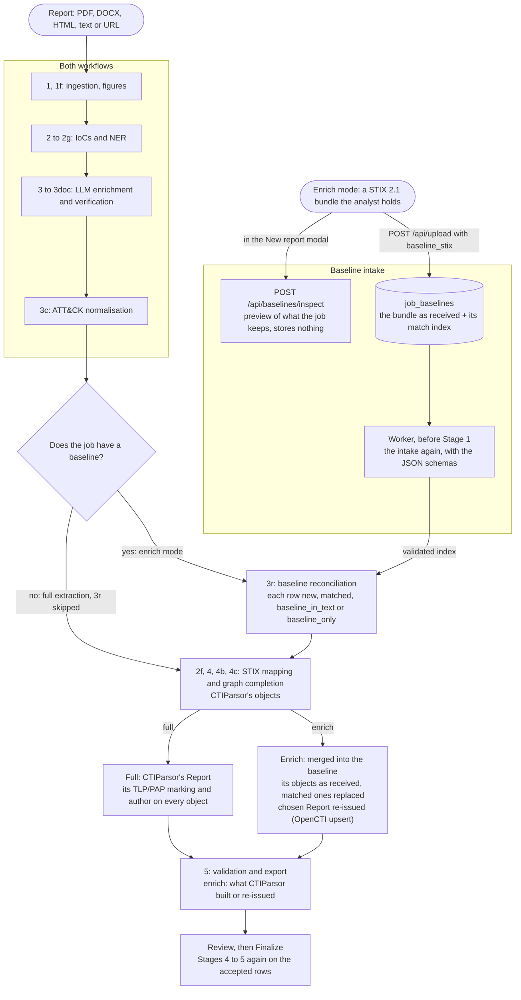

# Extraction pipeline

Every stage a report goes through, in execution order, what each one guards
against, and which of them need a network connection. The overview table is in
the [README](../README.md#how-it-works); this page is the detail.

- [Stages](#stages)
- [Extraction quality layers](#extraction-quality-layers)
- [MITRE ATT&CK data](#mitre-attck-data)
- [Offline support](#offline-support)

## Stages

Two workflows run the same stages (ADR-0090). **Full extraction** builds the
bundle from the report alone. **Enrich mode** starts from a STIX 2.1 bundle the
analyst already holds, the baseline: Stage 3r matches the run to it, and Stage 4
merges what the report adds into it. Stages 1 to 3c and 2f run the same way in
both. A full job skips Stage 3r and has no merge; in an enrich job Stage 5 does
not check the baseline objects again, validated once at intake.



The boxes below give each stage in detail, in execution order.

```
┌──────────────────────────────────────────────────────────────────────┐
│  Stage 1 — INGESTION                                    (offline ✅)  │
│  PDF / DOCX / HTML / TXT / MD → normalised text + chunks            │
│  • Text PDF    : markitdown (structure-preserving) → pdfplumber      │
│  • PDF tables  : rows whose IoC wrapped in its cell, rejoined and    │
│                  added after the text under a [[table rows …]] mark  │
│  • Scanned PDF : auto-detected → OCR via Tesseract / pdf2image       │
│  • Defanging   : hxxps://, [.], (.), .], [at], [@] → live form      │
│  • Chunking    : paragraph-aware + 400-char sliding-window overlap   │
│  • Adaptive    : larger chunks for large docs (3 000–5 000 chars)    │
└─────────────────────────────┬────────────────────────────────────────┘
                              │
┌─────────────────────────────▼────────────────────────────────────────┐
│  Stage 1f — FIGURE READING                       (opt-in — ADR-0032) │
│  PDF-only · off by default (VISION_PROVIDER=none)                    │
│  • Triage    : geometry discards 56.9% of images before any model    │
│  • Crops     : 150 DPI crops, not pages (977 tokens vs 2 191/page)   │
│  • Injection : transcription enters report_text in ⟦…⟧ sentinels     │
│  • Relations : attack-chain / network-diagram arrows → src -> dst    │
│  • Safety    : an unreadable figure is skipped, never costs the run  │
│  Enable: VISION_PROVIDER=anthropic|ollama|mistral|vllm in .env       │
└─────────────────────────────┬────────────────────────────────────────┘
                              │
┌─────────────────────────────▼────────────────────────────────────────┐
│  Stage 2 — REGEX IOC EXTRACTION                         (offline ✅)  │
│  IPv4/v6, domains, URLs, emails, MAC, ASN, file paths + filenames   │
│  Registry keys, MD5/SHA-1/SHA-256 (incl. line-wrapped hashes)        │
│  CVE IDs, raw MITRE ATT&CK IDs (T1234 / T1234.001) → ttp            │
│  spaCy GPE → location, if a model is installed; kept only if it can │
│  be a place name: "C&C", "XSS" go (NER_PRECISION_FILTERS, ADR-0088) │
└─────────────────────────────┬────────────────────────────────────────┘
                              │
┌─────────────────────────────▼────────────────────────────────────────┐
│  Stage 2b — GAZETTEER NER                               (offline ✅)  │
│  Aho-Corasick scan over 1 827 name variants (1 114 unique malware   │
│  families, offensive tools and APT groups — ATT&CK Ent + Mob + ICS) │
│  • Longest-match-wins, word-boundary checked                        │
│  • Confidence: 0.92 canonical / 0.88 alias                          │
└─────────────────────────────┬────────────────────────────────────────┘
                              │
┌─────────────────────────────▼────────────────────────────────────────┐
│  Stage 2c — SEMANTIC TTP DETECTION                      (offline ✅)  │
│  Sentence-transformer cosine-similarity against the pre-embedded    │
│  MITRE technique descriptions (local .npy cache)                    │
│  • Default model: all-MiniLM-L6-v2 (80 MB)                         │
│  • SecureBERT-Plus: +8-12% F1 is its paper's figure; ADR-0023       │
│    measured no gain here — not recommended                          │
│  • Model-aware tiers: ≥ high wins over LLM / medium = candidate     │
│    (MiniLM 0.62 / 0.48; resolved per-model — ADR-0011 Phase A)      │
│  • 1 match/sentence (top_k=1); TTP_TOP2_MARGIN guards any 2nd match  │
│  • ATT&CK-only by default (918 of 1 533): CAPEC shadows the real    │
│    technique, so it is excluded — TTP_SEMANTIC_DOMAINS=all restores │
│  • TTP_MODE=select (default): retrieves ranked candidates only —    │
│    ATT&CK descriptions + procedures, BM25 ⊕ dense; never a TTP      │
└─────────────────────────────┬────────────────────────────────────────┘
                              │
┌─────────────────────────────▼────────────────────────────────────────┐
│  Stage 2d — CyNER 2.0                       (offline once cached)   │
│  DeBERTa-v3 fine-tuned on cybersecurity NER (model card F1 91.88%)  │
│  Detects: Malware, Threat_group (threat-actor groups)               │
│  Model: PranavaKailash/CyNER-2.0-DeBERTa-v3-base (CYNER_ENABLED)    │
│  Threat_group: ordinary language is dropped ("cybercriminals",      │
│  "Iran", "Chinese threat actors") — NER_PRECISION_FILTERS, ADR-0088 │
└─────────────────────────────┬────────────────────────────────────────┘
                              │
┌─────────────────────────────▼────────────────────────────────────────┐
│  Stage 2e — GLiNER ZERO-SHOT NER                       (offline ✅)  │
│  Zero-shot NER with natural-language label descriptions              │
│  Detects entity types the gazetteer and CyNER cannot:               │
│    targeted sectors, campaign names, attack infrastructure,          │
│    novel actors & malware not yet in MITRE ATT&CK                   │
│  Default model: urchade/gliner_large-v2.1 (~1.8 GB)                 │
│  Configurable via GLINER_MODEL in .env                              │
└─────────────────────────────┬────────────────────────────────────────┘
                              │
┌─────────────────────────────▼────────────────────────────────────────┐
│  Stage 2g — ALIAS LISTS                                 (offline ✅)  │
│  Regex for the "X (aka Y, Z)" / "X, also known as Y and Z" construct │
│  • Every name in the list → threat actor (the dominant use of aka)   │
│  • Catches aliases no gazetteer or NER model knows yet               │
│  • Confidence 0.55: meant for review, calibrated like 2d/2e          │
└─────────────────────────────┬────────────────────────────────────────┘
                              │
┌─────────────────────────────▼────────────────────────────────────────┐
│  Stage 3 — LLM ENRICHMENT                (requires an LLM provider)  │
│  Input : chunk + pre-detected IoCs + gazetteer/NER context          │
│  Output: threat actors, malware families, tools, TTPs,              │
│          relationships (+ evidence quote), IoC→malware links,       │
│          targeted sectors/countries, course of action               │
│  • Parallel processing (configurable via LLM_PARALLELISM)           │
│  • Crash-resume: checkpoint saved every N chunks                     │
│  • Providers: Anthropic | Gemini | Mistral (hosted)                  │
│               Ollama | vLLM | LM Studio (local)                      │
└─────────────────────────────┬────────────────────────────────────────┘
                              │
┌─────────────────────────────▼────────────────────────────────────────┐
│  Stage 3b — HALLUCINATION FILTER                        (offline ✅)  │
│  Verifies each LLM-returned name against source chunk text           │
│  exact on word boundaries; fuzzy (rapidfuzz sliding window) only for│
│  multi-word names ≥ 8 chars without a digit — identifiers never:    │
│  • ≤ 5 chars (FIN7, APT1)   : exact only (92% similarity threshold │
│    constant kept for the record)                                   │
│  • 6–9 chars (Cobalt-S..)   : 80% similarity threshold             │
│  • ≥ 10 chars (Cobalt Strike): 75% similarity threshold            │
│  Campaign names: word-level fallback to avoid over-filtering        │
│  Names already confirmed by NER or doc context skip the fuzzy scan   │
└─────────────────────────────┬────────────────────────────────────────┘
                              │
┌─────────────────────────────▼────────────────────────────────────────┐
│  Stage 3d — RELATIONSHIP SELF-VERIFICATION              (optional)   │
│  Second LLM call: "quote the exact sentence supporting this claim"  │
│  Unsupported relationships are removed. Undecided ones (failed      │
│  call, no verdict, quote not in the text) are held for an analyst:  │
│  stored pending, out of the bundle until accepted (ADR-0082)        │
│  aCTIon paper: 27% → 8% hallucination on its benchmark; CTIParsor's│
│  own figure is the grounding harness's (docs/eval), not this one   │
│  Cost: ~1.4× total LLM calls (only chunks with ≥ 1 relationship)   │
│  Enable: ENABLE_STIX_VERIFICATION=true in .env                      │
└─────────────────────────────┬────────────────────────────────────────┘
                              │
┌─────────────────────────────▼────────────────────────────────────────┐
│  Stage 3f — TTP SELF-VERIFICATION                       (optional)   │
│  TTP analogue of 3d: second LLM call quotes the sentence describing │
│  each technique's USE (with its expected ATT&CK tactic); unsupported │
│  techniques are dropped. Semantic-corroborated TTPs are trusted and │
│  skipped, so cost tracks 3d (~1.4× calls — ADR-0011 Phase B).       │
│  Enable: ENABLE_TTP_VERIFICATION=true in .env                       │
│  TTP_MODE=select (default): selects among the retrieved candidates  │
│  and the LLM's own picks, exact quote checked by code; a failed     │
│  call ships nothing (candidates go to review); an answer cut off    │
│  at the output-token limit ships its complete, checked choices      │
│  the call stops at TTP_SELECT_MAX_OUTPUT_TOKENS (default: see below)│
└─────────────────────────────┬────────────────────────────────────────┘
                              │
┌─────────────────────────────▼────────────────────────────────────────┐
│  Stage 3e — CROSS-MODEL CONSENSUS                       (optional)   │
│  Re-runs every relationship-bearing chunk through a SECOND provider  │
│  and treats agreement as a trust signal — a model is a poor judge of │
│  its own hallucination; two different models disagreeing is signal.  │
│  • Agreed by both   : confidence +0.10                               │
│  • Primary only     : confidence −0.20, "observed" → "reported"      │
│  Enable: ENABLE_CONSENSUS=true + CONSENSUS_PROVIDER (≠ LLM_PROVIDER) │
└─────────────────────────────┬────────────────────────────────────────┘
                              │
┌─────────────────────────────▼────────────────────────────────────────┐
│  Stage 3doc — DOCUMENT-LEVEL RELATIONS        (optional — ADR-0057)  │
│  One extra LLM call over the WHOLE report, relationships only, for   │
│  facts stated far apart (paragraph 2 → paragraph 40)                 │
│  • Measured (ADR-0064): ~60% more correct relationships, but only    │
│    40% of the ones it adds are strictly correct                      │
│  • Needs a context window that fits the report and a long timeout    │
│  • Goes through 3d like the chunks when 3d is on                     │
│  Enable: ENABLE_DOCUMENT_LEVEL_RELATIONS=true in .env                │
└─────────────────────────────┬────────────────────────────────────────┘
                              │
┌─────────────────────────────▼────────────────────────────────────────┐
│  Stage 3c — MITRE ATT&CK NORMALISATION                 (offline ✅)  │
│  Runs ONCE per document, after every chunk is merged — not per chunk │
│  Fuzzy-matches extracted TTPs against the full ATT&CK corpus         │
│  (Enterprise + Mobile + ICS + CAPEC, compact local JSON index)       │
│  • Score ≥ 85 : canonical name + correct MITRE ID                    │
│  • Score 70–84: keep LLM phrasing, override ID                       │
│  • Score < 70 : pass through unchanged                               │
│  + Merge precision (ADR-0011): only HIGH-confidence semantic wins    │
│    over the LLM; parent technique dropped when a sub-technique fires │
└─────────────────────────────┬────────────────────────────────────────┘
                              │
┌─────────────────────────────▼────────────────────────────────────────┐
│  Stage 3r — BASELINE RECONCILIATION            (offline ✅ — ADR-0090)│
│  Enrich mode only: the job's baseline is the analyst's STIX bundle.  │
│  Full mode: skipped ("no baseline"). API: STIX_ENRICHMENT_ENABLED.   │
│  Matches what the run is about to write, in four passes:             │
│  • Extracted entities: by match key, names within a family           │
│  • Baseline entries nothing extracted: whole-word search in the text │
│       found → baseline_in_text; not found → baseline_only            │
│  • Extracted relationships: ends and verb match a baseline relation  │
│  • Baseline relations nothing extracted: imported                    │
│       baseline_in_text if both ends are found, else baseline_only    │
│  Rows get enrichment_status: new, matched, baseline_in_text or       │
│  baseline_only. A matched row: accepted, origin baseline_stix (D5).  │
│  Imported rows: source baseline_stix, pre-accepted, same origin.     │
│  Pure: an error fails the run; there is no fall back to full mode.   │
│  Stage 4 merges the baseline after 4b (ADR-0090 lot 4): see below.   │
└─────────────────────────────┬────────────────────────────────────────┘
                              │
┌─────────────────────────────▼────────────────────────────────────────┐
│  Stage 2f — CVE ENRICHMENT                  (cache; network opt-in)  │
│  Adds a description and a CVSS v3 score to each CVE's Vulnerability  │
│  (x_cvss_v3_score, x_cvss_v3_vector), from the cve_cache table       │
│  • CVE_ENRICHMENT=true: misses are looked up on the public CIRCL     │
│    API (≤ 25 lookups, ≤ 30 s per report); off by default             │
│  Runs just before Stage 4, despite its number                        │
└─────────────────────────────┬────────────────────────────────────────┘
                              │
┌─────────────────────────────▼────────────────────────────────────────┐
│  Stage 4 — STIX 2.1 MAPPING                            (offline ✅)  │
│  IoC → SCO  (IPv4Address, DomainName, File, URL, Email, MACAddr…)  │
│  Malware / Actor / Tool / TTP / CVE / Campaign / Infra → SDO        │
│  Location → SDO (targeted country, ISO 3166-1 lookup, 80+ nations)  │
│  Identity → SDO (targeted sector, identity_class=class)             │
│  CourseOfAction → SDO (recommended remediations)                    │
│  All accepted IoCs → Indicator → based-on → SCO   (ADR-0061)        │
│  IoC linked to malware → indicates SRO                              │
│  Threat actor → targets → Location / Identity SROs                 │
│  Semantic relations → Relationship SRO (deduplicated, spec-valid)    │
│  Every object: TLP/PAP marking + created_by_ref → authoring Identity │
└─────────────────────────────┬────────────────────────────────────────┘
                              │
┌─────────────────────────────▼────────────────────────────────────────┐
│  Stage 4b — GRAPH COMPLETION                (offline ✅ — ADR-0013)   │
│  Enriches edges AFTER the precision gate, never loosening it.        │
│  Runs before the Report SDO, so new edges are wrapped + stamped.     │
│  1. Alias merge     : OFF by default — aliases.py (ADR-0012) already │
│    (fallback)         canonicalises MITRE aliases at SDO creation.   │
│                       Fallback for non-gazetteer names only.         │
│  1b. ATT&CK grounding: add MITRE-curated edges (20 015 G/S/T pairs)  │
│                       when both endpoints resolve to ATT&CK IDs      │
│                       → x_evidence_label="reported" (expert fact)    │
│  2. Transitive infer : compose two verified edges via a fixed table  │
│                       (uses∘uses→uses …); a composed verb that is    │
│                       not spec-*suggested* is SKIPPED, not emitted   │
│  Every inferred edge: x_evidence_label="inferred" + x_inference_rule │
│  + x_inferred_from (premise ids). Pinned policy rules always win.    │
└─────────────────────────────┬────────────────────────────────────────┘
                              │
┌─────────────────────────────▼────────────────────────────────────────┐
│  Stage 4c — LONG-DISTANCE PREDICTION                    (optional)   │
│  Connects still-disconnected sub-graphs (CTINexus Phase 3):          │
│  DFS components → central node per component (degree centrality) →   │
│  topic node (global max degree) → ask the LLM for the relation.      │
│  Same evidence bar as 3d: the model must QUOTE the supporting        │
│  sentence, found in the report text (stored as x_evidence_text) —    │
│  no quote, or one the report does not hold ⟹ no edge.                │
│  Off unless policy completion.long_distance=true AND provider ready  │
│  (so Stage 4 stays network-free by default).                         │
└─────────────────────────────┬────────────────────────────────────────┘
                              │
┌─────────────────────────────▼────────────────────────────────────────┐
│  Stage 5 — VALIDATION & EXPORT                         (offline ✅)  │
│  stix2 library validates every object at construction time           │
│  stix2-validator JSON-schema check (schemas ship with the repo)      │
│  Enrich mode: the baseline objects, validated at intake, are not     │
│  checked again here (ADR-0090 lot 4); the file keeps every object.   │
│  Valid bundle → output/{report}_bundle.json                         │
│  Invalid bundle → output/{report}_bundle_invalid.json (for debug)   │
│  The verdict is stored with the bundle (jobs.bundle_validation):     │
│  invalid is not served (409) and never completes a job (ADR-0084)    │
└──────────────────────────────────────────────────────────────────────┘

On Finalize (web UI): Stages 4–5 run again on the accepted rows
(`re_run_final_stages`), and the rebuilt bundle is stored with Stage 5's verdict
and the record of the build that made it (`jobs.bundle_build_json`), unless a
bundle built from newer rows is already stored (ADR-0086). It writes the export
file in `output/` only when its build is stored. The rows it reads are the ones
that ship (`accepted`, or pending without a hold). In an `enrich` job the rows the
baseline supplies are not rebuilt: a `baseline_only` entity and an imported
relationship (`enrichment_status` `baseline_in_text` or `baseline_only`) are left
out, and the baseline object ships as received (ADR-0090 lot 4). A
`baseline_in_text` entity is still read, and the merge replaces it by the
baseline object it matches.
```

**Stage 4 in enrich mode (ADR-0090).** Stage 4 builds CTIParsor's objects as in a
full job, runs Stage 4b on them alone, and then merges the analyst's baseline into
them (`merge_baseline`, `pipeline/baseline_stix.py`). A CTIParsor object that a
kept baseline object matches is replaced by it, and a relationship that becomes a
self-loop or repeats a baseline relationship is dropped. The baseline objects are
written back as received, with neither CTIParsor's marking nor its author. When the
baseline has a chosen Report, that Report is re-issued under its own id, as an
OpenCTI upsert, instead of a CTIParsor Report
([the enriched bundle](stix-output.md#enriched-bundle-adr-0090)). In a run, the baseline
entries that nothing extracted but the text names (`baseline_in_text`) join the run's
entities before Stage 4 maps them, as a finalize builds them from the stored rows
(`pipeline/orchestrator.py`). Stage 3r runs only when the document has a
baseline (`pipeline/orchestrator.py`). The API reads `STIX_ENRICHMENT_ENABLED`
(on by default) and answers 400 to a request that carries a baseline while it is off
(`api/routes/_common.py`).

**Stage 5 in enrich mode** validates what CTIParsor built or re-issued, not the
baseline objects, which were validated once at intake. The file keeps every object.

**The API worker, the `main.py` CLI and the `--stage full` benchmark run the
same sequence of stages** (`pipeline/orchestrator.py`, ADR-0059); they differ
only in what happens around it (job store, progress events, crash-resume).
Every run records which stages ran, were skipped (disabled, model missing, no
LLM provider) or failed — the CLI prints it, the worker stores it in the job's
run config (`stage_report`).

**Stage 5's verdict decides what the API serves** (ADR-0084). The worker stores
it with the bundle: `jobs.bundle_validation` is `validated`, `unverified` (the
JSON schemas are missing) or `invalid`, and `jobs.bundle_validation_errors`
holds the first 20 error messages. An `invalid` bundle is not served
(`GET /api/jobs/{id}/bundle` answers 409 with the errors) and never completes a
job: a full finalize leaves the status alone, and a `completed` job goes back to
`for_review`. The initial run still stores the job `for_review`. A bundle built
before the verdict was stored has none and is served as before. The CLI already
returned failure on an invalid bundle.

**A stored bundle names the build that made it** (ADR-0086). The run config
(`jobs.run_config_json`) describes the run. A finalize rebuilds Stages 4–5 with
the policy, data and code of the process that serves it, so it writes its own
record, `jobs.bundle_build_json`: kind (`run`, `finalize` or `quick`), time,
`git_rev`, policy, the captured environment variables (an allow-list, never a
scan) and the manifest. A run writes a `run` record copied from its run config.
Freshness against `BUNDLE_AFFECTING` (ADR-0035) follows the fix's scope: a
`mapping` fix (Stages 4–5 only) is judged on the build's revision, so a finalize
clears it; an `extraction` fix (Stages 1–3) is judged on the run's revision as
well, so only a new run clears it. A finalize reads the job's rows in one
snapshot and does not replace a bundle built from newer rows (a slower finalize
cannot overwrite a faster one that read later). The run config's
`entity_overrides` gains `fingerprint`, a hash of the active deny and promote
rows; the build record carries no overrides, since Stages 4–5 never read them.

Stage order note: 3b, 3d, 3f and 3e run **per chunk**; 3doc reads the whole
document once and its result joins the per-chunk ones; 3c runs **once per
document**, after every result has been merged; 3r (enrich mode only, ADR-0090)
runs once per document after 3c, on the merged result; 2f runs right before
Stage 4, whose Vulnerability objects it feeds. The boxes are drawn in that
execution order, the order of the CLI's stage ids too:
`1 1f 2 2b 2c 2d 2e 2g 3 3d 3f 3e 3doc 3r 2f 4 4b 4c 5` (3b and 3c have no id of
their own: 3b is part of Stage 3, 3c always runs).

## Extraction quality layers

### 0. What a figure read returns (Stage 1f)

The model is constrained by a JSON schema and returns four fields.

| Field | What it is | Where it goes |
|---|---|---|
| `figure_kind` | One of eight predefined categories | Determines the block header and controls whether arrows are rendered |
| `verbatim_text` | Text lines transcribed directly from the image | Injected into `report_text`, making it visible to Stage 2 regex and all subsequent stages as if it were body text |
| `edges` | `src → dst → label` triples extracted from diagrams | Rendered as `src -> dst` lines within the block, applicable only to `attack-chain` and `network-diagram` types |
| `iocs` | Values identified by the model as indicators | **Not injected** — see the note below |

The `figure_kind` field accepts one of eight values: `network-diagram`, `attack-chain`, `screenshot`, `code-listing`, `table`, `chart`, `logo`, and `none`. Three of these values—`logo`, `none`, and `unread` (which the pipeline assigns when reading fails)—result in an empty block. The figure retains its ordinal number regardless of the kind assigned; otherwise, numbering would shift based on model decisions, causing a `⟦figure 7⟧` reference to point to different images across runs.

**What the model is told besides the image**

The crop does not travel alone. Each read carries the text in a band around the figure and the head of the report, which MM-AttacKG's ablation (arXiv:2506.16968, Table 3) measures at roughly **7 points of entity F1** — 0.7716 with both context sources, 0.7022 with neither — for no extra call.

The context block opens with an explicit prohibition: this text is not in the image and must never appear in `verbatim_text`, `iocs` or `edges`. Without it the model transcribes the surrounding prose as though it had read it off the page, pushing report text back into `report_text` a second time inside a figure block.

**Why `iocs` is not injected**

Measured over two production runs — 26 figures carrying content — **63 of 64** listed IoCs were already in the transcription, so injecting the list buys almost no recall. The one that was not is a phishing URL the model transcribed twice and garbled differently each time, so injecting it would have added a domain that does not exist (ADR-0032, amendment of 2026-08-30). The reason not to inject it is what the exception would cost: an IoC present in the `iocs` list but absent from `verbatim_text` is a model assertion not grounded in its own transcription. Injecting such values would introduce data into the bundle that no stage can verify—precisely the class of hallucination that Stage 3b and Stage 3d are designed to prevent. Consequently, image-derived IoCs reach the pipeline through a single path: the model transcribes them into `verbatim_text`, which is injected into `report_text` before Stage 2 executes, allowing regex patterns to extract them exactly as they would from document body text.

| Limit | Value | What happens at it |
|---|---|---|
| Context sent with each crop | 1200 chars around the figure, 600 of the report head | A band of ±250 pt, not the whole page: on a web capture one page holds 18 371 characters and 18 figures, so page-level text would hand each of them the same navigation menu |
| Figures read per PDF | 40 | Additional candidates are dropped, logged as a warning, with no indication in the bundle |
| Arrows rendered per figure | 24 | Further edges from the same figure are not rendered |
| Crop render resolution | 150 DPI | Only crops are processed, never whole pages |

### 1. Multi-layer NER (Stages 2b–2e)

Each NER stage adds a different capability:

| Stage | Method | Entities found |
|---|---|---|
| 2 | Regex, spaCy | IoCs (IPs, hashes, domains, CVEs, paths…); places, when a spaCy model is installed, kept only if they can be a place name (ADR-0088) |
| 2b | Aho-Corasick gazetteer | Known malware/tools/APT groups |
| 2c | Semantic embeddings | MITRE techniques by meaning, not name |
| 2d | CyNER 2.0 (DeBERTa-v3) | Cybersecurity NER — malware & threat-actor groups; a threat actor written as ordinary language is dropped (ADR-0088) |
| 2e | GLiNER zero-shot | Sectors, campaigns, infrastructure, novel actors |

The gazetteer's ordinary-word policy (`GAZETTEER_POLICY`; the reviewed forms are in
[gazetteer-ordinary-words.md](gazetteer-ordinary-words.md)) judges each occurrence of
a form that is also an ordinary word. In `shadow` (the default) Stage 2b emits what
it emits without the policy, and its stage report counts, by reason (`policy_*`), the
occurrences the policy would withhold. In `apply` it withholds every occurrence that
is not resolved (unresolved or excluded) before it claims a span, so a later
qualifying mention is still found; a withheld occurrence claims neither its span nor
its canonical name, and the counts are the withheld occurrences by reason. An
analyst-promoted term is not judged (ADR-0052). `apply` is for measurement until the
acceptance gates pass; `off` has no policy and no counts
([configuration](configuration.md)).

Stage 2 drops an email or ASN match that is glued to a cased letter or a digit on
either side (`glued_to_a_word`, ADR-0049): `o@evil.com` is not cut out of
`joão@evil.com`. Chinese, Japanese, Korean and Thai characters do not glue a match.

### 2. Sliding-window chunk overlap (Stage 1)

```
Chunk N:   [...──────── entity ─────]
Chunk N+1:       [──── entity ─────────...]
                ↑ 400-char overlap
```

Named entities at chunk boundaries appear in both adjacent chunks. De-duplicated at merge. Estimated: +5–12% recall on long documents.

Two more Stage 1 limits. A `.docx` whose parts would inflate past 512 MiB is refused
before it is parsed (`_check_docx_size`, `pipeline/stage1_ingestion.py`). OCR
runs in batches of ten pages: a Tesseract failure on one page is logged and costs only
that page, and a batch that cannot be rendered is logged and skipped whole
(`pipeline/stage1_ingestion.py`).

### 3. Hallucination filter (Stage 3b)

After every LLM call, each returned name is checked against the source chunk text: an exact match on word boundaries first, then — only for a multi-word name of 8 characters or more with no digit — a fuzzy sliding-window match whose threshold depends on length. A name with a digit (UNC4736, APT28, Storm-0558), a short name or a single token is never fuzzy-matched: the window used to accept the *neighbouring* identifier (UNC4763 for UNC4736, APT2 for APT28, BlackBasta for BlackCat — reproduced by the October 2026 audit), and a wrong attribution is the costliest error an extractor can make. Names that fail are dropped and logged.

| Name | Strategy | Threshold |
|---|---|---|
| ≤ 5 chars, any name with a digit, any single token | Exact (word boundaries) | — |
| 6–9 chars, multi-word, no digit | Exact + fuzzy | 80% |
| ≥ 10 chars, multi-word, no digit | Exact + fuzzy | 75% |
| Campaign names | Word-level keyword fallback | — |

Two more rules apply to a Stage 3 answer. An answer that fails the schema loses only
the items the error points at: `_drop_invalid_entries` removes them (a top-level field
of the wrong type takes its default), and the answer is validated again, at most five
times. The log counts the items dropped when the answer then validates. When the error
points at nothing removable, or the fifth attempt still fails, the answer counts as
`extraction_invalid` and the chunk gets an empty result (`pipeline/stage3_llm.py`).
When Stage 3 stops on a timeout or an error, the chunks still queued are
cancelled and never sent; the calls already running are not awaited and finish on their
own (`pipeline/orchestrator.py`).

### 4. MITRE normalisation (Stage 3c)

Fuzzy-matched against the full ATT&CK corpus. The ~40% of wrong or invented MITRE IDs it was expected to remove is an estimate, not measured here. Merge precision (ADR-0011): only a **high-confidence** semantic match overrides the LLM — a medium-confidence one is kept only when the LLM is silent and never wins the dedup. When a sub-technique (`T1059.001`) is present, its parent (`T1059`) is dropped as redundant.

### 5. Relationship self-verification (Stage 3d)

Second LLM call per chunk quotes the exact supporting sentence for every relationship. Unsupported relationships are dropped. The aCTIon paper reports a hallucination rate falling from ~27% to ~8% on its own benchmark; CTIParsor's measured figure is the grounding harness's (≈ 11 % named-entity relationship hallucination on a 4-report corpus, see the ADR-0012 note below).

### 6. TTP self-verification (Stage 3f)

The TTP analogue of Stage 3d (ADR-0011 Phase B). For each LLM-extracted technique, a second LLM call must quote the sentence describing that technique being *used* — annotated with the technique's expected ATT&CK tactic so a behaviour-vs-tactic mismatch is also rejected. Enable with `ENABLE_TTP_VERIFICATION` (recommended on — without it TTPs pass no evidence gate while relationships pass two).

Only a **high-confidence** semantic match (cosine ≥ the model's high cut-point) waives the check. That floor matters: a *medium* match (≥ 0.48) is precisely the nearest-but-wrong tier the Phase A margin gate exists to suppress, so letting it grant a bypass would hand the weakest signal in the pipeline veto power over the strongest check. On a real 12-page report, 13 of 16 corroborators sat below the cut-point and were waving through techniques with no textual support at all.

In `select` mode the stage report counts two kinds of 3f answer apart. `truncated`
answers were cut off before their end: their complete choices are validated, and their
other candidates go to review (ADR-0072, amendment of 2026-10-19). `at_ceiling` answers
were stopped by the provider at the selection call's output ceiling, cut or not
(amendment of 2026-10-20), so one answer can count in both
(`pipeline/orchestrator.py`). The ceiling is `TTP_SELECT_MAX_OUTPUT_TOKENS`
when set, never above `LLM_MAX_OUTPUT_TOKENS`; unset, it is 4,096 on vLLM with thinking
off and `LLM_MAX_OUTPUT_TOKENS` otherwise (`pipeline/stage3f_ttp_select.py`).

### 6b. Why TTP counts stay bounded

A report with no explicit T-IDs is where technique counts run away, because every entry is inferred. Four controls keep the number honest:

| Control | Effect |
|---|---|
| Stage 3f verification | drops techniques with no supporting sentence |
| High-confidence corroboration floor | stops weak semantic matches waiving 3f |
| Cross-source dedup at persistence | one row per technique, not one per source — the review UI matches the bundle |
| Parent/sub subsumption across sources | `T1027` dropped when `T1027.004` is present, even when the two came from different stages |
| ATT&CK-only semantic corpus | removes CAPEC near-duplicates of the technique that belongs in the bundle |

### 7. Report lexicon re-scan (removed)

A full **Finalize** used to re-scan the text for the accepted named entities and insert the occurrences NER and the LLM had missed, with `source="report_lexicon"`. It could never insert a row: it skipped every value already accepted, which is every value it scanned (the one exception, a stored value with surrounding whitespace, would have been a duplicate). It was removed on 2026-10-17 (audit Q03). Rows already stored with that source stay readable. `quick` in `re_run_final_stages` now only decides whether the rebuild completes the job: the manual Finalize does, the debounced auto-finalize does not.

### 8. Entity canonicalisation & relationship precision (Stage 4, ADR-0012)

`pipeline/aliases.py` builds an offline MITRE alias index from `gazetteer.json` +
`mitre_index.json` (no new dependencies). Stage 4 uses it to:

- **Merge aliases** — `APT34` and `OilRig` (MITRE group G0049) collapse into one
  `threat-actor` SDO instead of two, and a relationship naming *any* alias resolves
  to the merged node.
- **Drop spurious edges** — an observable ↔ attack-pattern relationship
  (e.g. `domain communicates-with T1071.001`) is a type error; it is dropped, not
  emitted as a noisy `related-to`.
- **Route observables through their indicator** — any other relationship
  touching a raw observable (LLM-extracted or policy-pinned) is re-anchored on
  that observable's `indicator` rather than the SCO itself (ADR-0041), unless
  STIX 2.1 defines the verb for the observable itself: `malware
  communicates-with domain-name`, `malware drops file` or `infrastructure
  consists-of ipv4-addr` stay on the observable, since through the indicator
  they could only ship as `related-to` (ADR-0062). Scoped to observable↔SDO
  pairs only — observable↔observable facts (`file related-to ipv4-addr`) are
  left as-is, since the spec's real answer for those is embedded ref
  properties, not a relationship object.
- **One type per name** (ADR-0092) — a name typed as more than one of malware, threat
  actor, tool and campaign keeps the type or types of its best-ranked source
  (`TYPE_PRECEDENCE`, `pipeline/base.py`, lowest rank first: the analyst's own rows
  −1, `ioc` and `gazetteer` 0, `semantic` and `llm` 1, `cyner` and `gliner` 2,
  `spacy` and `alias_list` 3, any other source 99). A campaign ranks after every
  source but the analyst's rows; equal ranks keep all their types. The types left out
  go to the ledger as `dropped / outranked_type` and do not reach Stage 4
  (`pipeline/named_entities.py`, `pipeline/orchestrator.py`).
- **Ends that name several objects** (ADR-0091) — when an end names several candidate
  objects, the verb picks the pair it accepts (`rel_is_allowed`). When several pairs
  fit, or none does, the row is not built and the ledger records `ambiguous_name`
  (`pipeline/stage4_stix_mapping.py`).
- **URLs** — a value that is not a valid URI gives no `url` SCO. It is not repaired:
  the ledger records it `dropped` with reason `not_a_uri`
  (`pipeline/stage4_stix_mapping.py`).

Measured effect on a 4-report corpus: named-entity relationship hallucination
≈ 11 % (the tractable target), entity hallucination ≈ 0. See
[ADR-0012](adr/0012-hallucination-measurement-and-canonicalization.md) /
[ADR-0041](adr/0041-observables-route-through-indicators.md) /
[ADR-0062](adr/0062-observables-keep-their-listed-relationships.md).

### 9. What was rejected or held stays out (Stage 4, 4b)

No later stage adds back a relationship an analyst rejected, or one Stage 3d held that
nobody has decided yet (ADR-0082). Stage 4 and graph completion both receive the
triples of these rows as `forbidden`, and each refusal is recorded in the mapping
ledger with its origin (ADR-0013, amendment of 2026-10-26).

- Graph completion (Stage 4b) refuses such a triple in ATT&CK grounding, in transitive
  inference and in long-distance prediction (`pipeline/stage4b_graph_completion.py`).
  A verb that names no direction (`related-to`, `duplicate-of`)
  refuses the reverse triple too (`both_directions`).
- Stage 4 applies the same rule to the edges that have no review row of their own: the
  `targets` product from each threat actor to each targeted location or sector, the
  policy's pinned rules, and the `indicates` edge of an IoC association. An IoC whose
  `indicates` edge is refused keeps its Indicator; only the edge is left out
  (`pipeline/stage4_stix_mapping.py`).
- The finalize also reads the rejected and held relationship rows, but only to refuse
  their triples; it never ships them (`api/worker.py`).

## MITRE ATT&CK data

Stages 2b, 2c, 3c, 3f, 4 and 4b use pre-built local indexes in `pipeline/data/`. That
directory is the **default track**, ATT&CK 19.2 (named by
`pipeline/data/attack_manifest.json`). `ATTACK_RELEASE=20.0` makes a process
read `pipeline/data/attack/20.0/` instead, which holds the same index files built
from ATT&CK v20.0 and its own `attack_manifest.json` (ADR-0087,
[configuration](configuration.md#attck-release)).

An unknown `ATTACK_RELEASE` stops the run before Stage 1 (ADR-0087,
`pipeline/orchestrator.py`). A Stage 3 checkpoint is resumed only when its
fingerprint matches, and the release is one of the settings that fingerprint hashes
(`pipeline/stage3_llm.py`, `pipeline/orchestrator.py`): a checkpoint
written on one track is not resumed on the other.

### Build the indexes

```bash
# pipeline/data/*.json/*.npy ship pre-built and committed to git — this is only
# needed to rebuild them after a MITRE ATT&CK release update.
docker compose run --rm dev python scripts/build_indexes.py

# Or build only specific indexes
docker compose run --rm dev python scripts/build_indexes.py --only mitre         # mitre_index.json
docker compose run --rm dev python scripts/build_indexes.py --only gazetteer     # gazetteer.json
docker compose run --rm dev python scripts/build_indexes.py --only embeddings    # mitre_embeddings.npy
docker compose run --rm dev python scripts/build_indexes.py --only relationships # attack_relationships.json

# Only on request: the candidate corpus of TTP_MODE=select, the default (ADR-0072)
docker compose run --rm dev python scripts/build_indexes.py --only retrieval     # attack_retrieval_*

# Write to another directory instead of pipeline/data/ (a release track, ADR-0087);
# --capec-index carries the CAPEC entries of an existing mitre_index.json over
# when no CAPEC bundle is given
docker compose run --rm dev python scripts/build_indexes.py --out-dir DIR --capec-index pipeline/data/mitre_index.json
```

The script auto-discovers bundle files in `data/`, `~/Downloads/`, and `~/Documents/`. Accepts `--enterprise`, `--mobile`, `--ics`, `--capec` flags for explicit paths.

To ship a **new ATT&CK release**, build a track rather than rebuilding the
default files: `python scripts/download_attack.py --release X.Y` fetches the
bundles and checks each against GitHub's sha256, then
`scripts/build_attack_release.py --release X.Y` builds `pipeline/data/attack/X.Y/`
from them (it calls the builders of `build_indexes.py` with an output directory, adds the
track's own `attack_manifest.json`, and refuses to overwrite a track without
`--force`). Rebuilding the default files in place changes their hashes: the run
manifest then lists them under `attack.modified_files`, and the release
`attack_manifest.json` names is no longer proven for them.

| File | Stage | Size | In git |
|---|---|---|---|
| `pipeline/data/mitre_index.json` | 3c normalisation | ~750 KB | yes |
| `pipeline/data/gazetteer.json` | 2b gazetteer NER | ~280 KB | yes |
| `pipeline/data/attack_relationships.json` | 4b ATT&CK grounding | ~600 KB | yes |
| `pipeline/data/mitre_embeddings.npy` | 2c semantic TTP | ~2.3 MB | yes |
| `pipeline/data/mitre_embeddings_meta.json` | 2c semantic TTP | ~190 KB | yes |
| `pipeline/data/mitre_embeddings_manifest.json` | 2c cache validity + thresholds | ~1 KB | no — written by `--only embeddings` |
| `pipeline/data/attack_retrieval_corpus.json` | 2c candidate retrieval (`TTP_MODE=select`) | ~7 MB | yes — `--only retrieval` |
| `pipeline/data/attack_retrieval_embeddings.npy` | 2c candidate retrieval (`TTP_MODE=select`) | ~27 MB | yes — `--only retrieval` |
| `pipeline/data/attack_revoked.json` | 3c revoked ids and their replacements | ~5 KB | yes — `--only revoked` |
| `pipeline/data/attack_manifest.json` | the default track's release (19.2), what was checked against a rebuild, the sha256 of its files; read by the run manifest and by `ATTACK_RELEASE` | ~4 KB | yes — no script writes it (ADR-0087) |
| `pipeline/data/attack/20.0/` | the v20.0 track: the eight index files above (no embeddings manifest) built from ATT&CK v20.0, and its own `attack_manifest.json`; read when `ATTACK_RELEASE=20.0` | ~39.9 MB | yes — `scripts/build_attack_release.py --release 20.0` |

The eight index files and `attack_manifest.json` of the default track are all a
fresh clone needs. A track under `pipeline/data/attack/` is optional: it is read
only when `ATTACK_RELEASE` names it. Rebuild a track only after a MITRE ATT&CK
release, and commit the result to avoid a per-clone rebuild.

> The **manifest** records the model the cache was built with (so Stage 2c can detect a stale cache after `TTP_EMBEDDING_MODEL` changes) and the calibrated `thresholds` (`high`/`medium`) for that model — written by `build_indexes.py --only embeddings` (ADR-0011 Phase A). It is not in git: without it Stage 2c assumes the committed cache was built with the default `all-MiniLM-L6-v2` and uses that model's thresholds, which is true of the committed files. Switching model means rebuilding the embeddings, which writes it.

The retrieval corpus holds one entry per technique and one per distinct ATT&CK
procedure example, with actor and software names replaced by placeholders
(`--keep-names` keeps them). It is committed since select mode became the
default: the file a clone and the image carry is the one the dev evaluation
measured (docs/eval/baseline-2026-10.md), and without it select mode selects
among the LLM's proposals only, which measured worse in recall than `verify`.
Like any index rebuilt here, the `dev` container writes it into the repository
and the image picks it up at the next build (`pipeline/data/` is baked in,
read-only at run time).

## Offline support

| Component | Offline |
|---|---|
| Stages 1, 2, 4, 5 | ✅ fully offline |
| Stage 4b — graph completion (alias, grounding, transitive) | ✅ fully offline (grounding needs `build_indexes.py --only relationships`) |
| Stage 4c — long-distance prediction (opt-in) | ❌ requires an LLM provider |
| Stage 2b — gazetteer NER | ✅ after `build_indexes.py` |
| Stage 2c — semantic TTP | ✅ after `build_indexes.py` + model download |
| Stage 2e — GLiNER | ✅ after first model download (~1.8 GB cached) |
| Stage 3b — hallucination filter | ✅ fully offline (rapidfuzz) |
| Stage 3c — MITRE normalisation + merge precision | ✅ after `build_indexes.py` |
| Stage 3f — TTP self-verification (opt-in) | ❌ requires an LLM provider |
| Stage 2g — alias lists | ✅ fully offline (regex) |
| Stage 2f — CVE enrichment | ✅ from the `cve_cache` table; ❌ the CIRCL lookup, opt-in with `CVE_ENRICHMENT=true` |
| Stage 3 — Anthropic / Gemini / Mistral | ❌ requires internet |
| Stage 3 — Ollama / vLLM / LM Studio | ✅ if the server is local |
| Stage 3doc — document-level relations (opt-in) | ❌ requires an LLM provider |
| Stage 3r — baseline reconciliation (enrich mode only) | ✅ fully offline (pure; needs the analyst's STIX bundle) |
| OCR (Tesseract) | ✅ local binary |
| Web UI (frontend assets) | ✅ served from local dist/ |
| Detection coverage (Sigma, Suricata, YARA) | ✅ after `sync_corpora` (one-time clone) + `build_detection_index` |

Stage 2f stops its CIRCL lookups for a report at the first one that gets no
answer: that CVE and those not yet looked up stay unenriched, and are asked again
on the next run (`pipeline/stage2f_cve_enrichment.py`).
